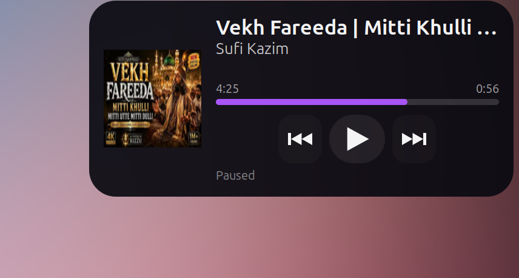

# Cinnamon Music Pill

A lightweight, borderless music now-playing desklet for **Cinnamon Desktop**.

Cinnamon Music Pill reads media information and sends playback commands through **MPRIS / D-Bus**. It is designed to stay visually polished while avoiding continuous system-monitor-style polling.



## Features

- MPRIS/D-Bus player detection
- Album artwork
- Track title and artist
- Optional album name
- Progress bar and elapsed/remaining time
- Play / Pause
- Previous / Next
- Automatic active-player selection
- Optional player preference / MPRIS bus name
- Mini, Medium and Large layouts
- Custom scale: **60%–200%**
- Manual fixed height: **0–600 px** (`0` = automatic)
- Background opacity: **20%–100%**
- Custom accent color
- Optional artwork and progress bar
- Borderless dark/glass-style UI
- Event-driven player property updates
- Position timer runs only while media is playing

## Requirements

- Linux Mint / Cinnamon or another compatible Cinnamon desktop
- Cinnamon 5.6–6.6
- A media player exposing MPRIS on the session D-Bus

Common MPRIS players include Spotify, VLC and compatible Linux media players.

### Browser / YouTube

A normal Firefox/Chrome YouTube tab does **not always expose an MPRIS player by itself**. For browser media, use an MPRIS browser bridge/extension that exposes the tab as an MPRIS player.

Cinnamon Music Pill does not scrape YouTube and does not continuously poll the browser.

## Installation

### Manual Installation

Copy the desklet directory into:

```text
~/.local/share/cinnamon/desklets/cinnamon-music-pill@ammar/
```

For example:

```bash
mkdir -p ~/.local/share/cinnamon/desklets
cp -r cinnamon-music-pill ~/.local/share/cinnamon/desklets/cinnamon-music-pill@ammar
```

Then restart Cinnamon or log out/in:

```bash
cinnamon --replace & disown
```

Open:

**Right-click desktop → Add Desklets → Cinnamon Music Pill → Add**

## Configuration

Open the desklet's **Configure** menu.

### Appearance

| Setting | Range / options | Description |
|---|---|---|
| Widget Size | Mini / Medium / Large | Select the base layout |
| Widget Scale | 60–200% | Scales the widget dimensions |
| Background Opacity | 20–100% | Controls widget transparency |
| Fixed Height | 0–600 px | `0` uses automatic height |
| Accent Color | Color | Progress/playback accent |
| Show Album Artwork | On/Off | Hide artwork when desired |
| Show Progress | On/Off | Hide the progress section when desired |

### Behavior

| Setting | Description |
|---|---|
| Player Selection | Automatic, Spotify, VLC, or Firefox/browser bridge |
| Preferred Player | Optional full MPRIS bus name |

For example:

```text
org.mpris.MediaPlayer2.spotify
```

## Performance design

Cinnamon Music Pill intentionally avoids expensive visualizers and continuous high-frequency polling.

- MPRIS `PropertiesChanged` events update metadata/state.
- A lightweight 1-second position timer is active only while playback is running.
- Playback commands use asynchronous D-Bus calls.
- Album artwork is placed inside a fixed-size container.

## Troubleshooting

### Desklet does not appear

Check that the directory and UUID match exactly:

```bash
ls ~/.local/share/cinnamon/desklets/cinnamon-music-pill@ammar/
```

The directory must contain `metadata.json`, `desklet.js`, `settings-schema.json` and `stylesheet.css`.

### No player detected

Check whether an MPRIS service exists:

```bash
gdbus call --session \
  --dest org.freedesktop.DBus \
  --object-path /org/freedesktop/DBus \
  --method org.freedesktop.DBus.ListNames | grep org.mpris.MediaPlayer2
```

If nothing is returned, your player is not currently exposing MPRIS.

### YouTube is not detected

Install/configure an MPRIS browser bridge. A regular browser tab is not guaranteed to appear on the session D-Bus.

### Play/Pause action works but the UI is stale

Restart Cinnamon and verify that only one copy of the desklet is installed. The current implementation updates the existing control immediately and then synchronizes against the player's authoritative MPRIS state.

## Development

The project is intentionally a small Cinnamon desklet with no build system.

Main files:

```text
cinnamon-music-pill@ammar/
├── metadata.json
├── desklet.js
├── settings-schema.json
├── stylesheet.css
├── CHANGELOG.md
├── LICENSE
├── README.md
└── assets/
    └── preview.png
```

After editing files, restart Cinnamon or reload the desklet.

## License

MIT License. See [LICENSE](LICENSE).

## Credits

Created by **Ammar Abid** for the Cinnamon desktop ecosystem.
